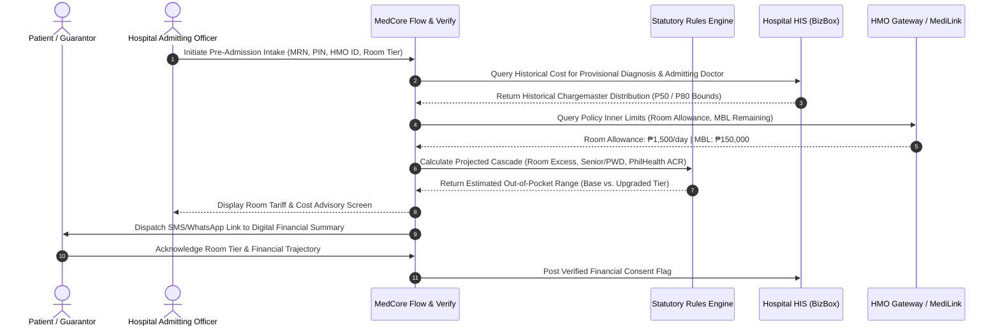
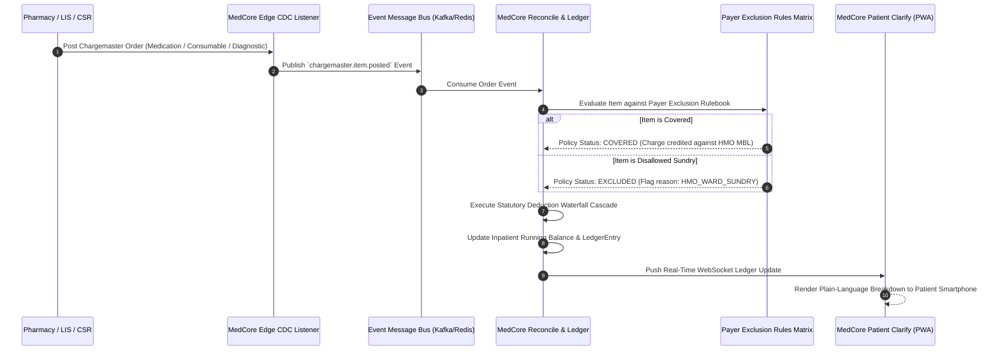
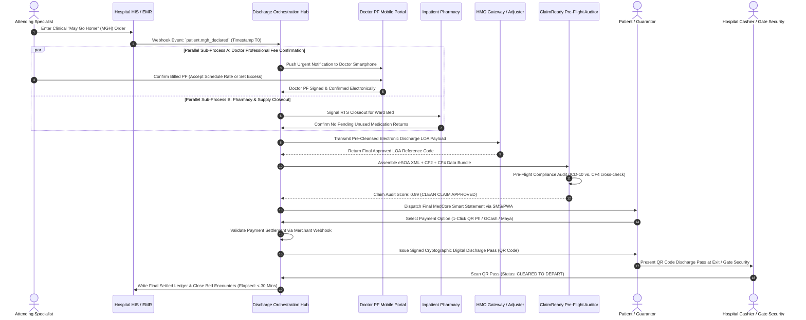

# SYSTEM/workflows.md — Technical Sequence Diagrams & Execution Workflows

> **Epistemic Status**: Systems Engineering Workflows & Sequence Specifications  
> **Knowledge Layer**: Product Intelligence Vault (`MedCore_Vault/SYSTEM/`)  
> **Cross-References**: [architecture.md](architecture.md), [entities.md](entities.md), [PRODUCT/workflows.md](../PRODUCT/workflows.md)

---

## 1. Sequence 1: Pre-Admission Estimation & Room Category Validation

[DECISION] This sequence executes during patient registration and intake (Stage 1: GUIDE), providing upfront financial orientation and preventing room-tier differential surprises:

---

## 2. Sequence 2: Live Order Reconciliation & Running Balance Updates

[DECISION] This asynchronous event-driven workflow executes continuously whenever a departmental charge or medication order is posted during hospitalization (Stage 3: RECONCILE):

---

## 3. Sequence 3: Discharge Clearance Coordination Workflow

[DECISION] This is the core operational sequence that collapses the discharge clearance process from **4 to 8+ hours down to under 45 minutes** (targeting **<30 minutes**):

